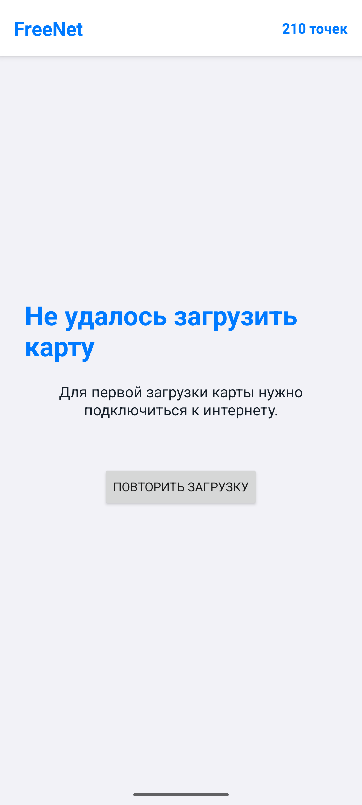
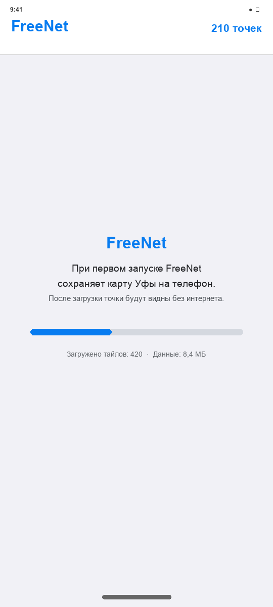
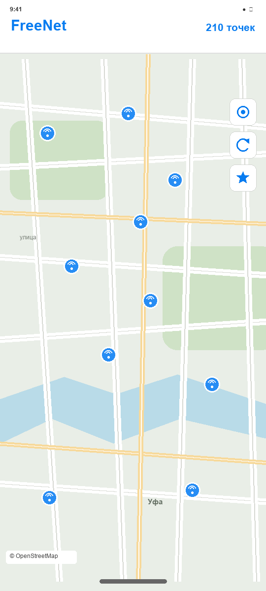
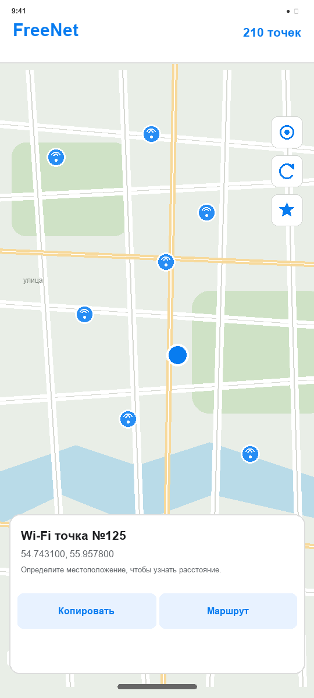
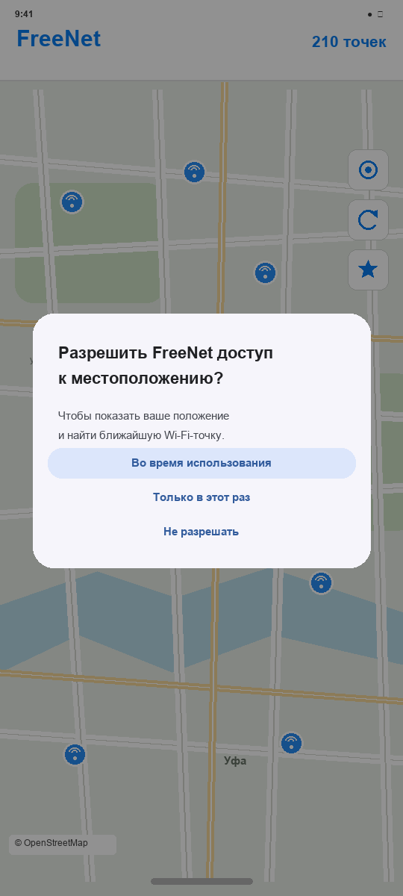

# FreeNet — Wi-Fi-точки Уфы

FreeNet — учебный проект для просмотра бесплатных Wi-Fi-точек в Уфе. В репозитории сохранена исходная веб-версия и добавлено Android-приложение на Java. В Android-приложении координаты точек находятся в самом приложении, а картографическая подложка скачивается один раз и после этого доступна офлайн.

## Возможности Android-приложения

- Карта Уфы с 210 Wi-Fi-точками из исходного списка.
- Первичная загрузка участка карты с индикатором прогресса и кнопкой повтора при сетевой ошибке.
- Просмотр сохранённой карты и точек без интернета после завершения первой загрузки.
- Определение текущего местоположения по запросу пользователя.
- Поиск ближайшей Wi-Fi-точки и расчёт примерного расстояния.
- Копирование координат выбранной точки.
- Открытие маршрута во внешнем приложении Яндекс Карты.
- Комментарии на русском языке в Java-коде, чтобы проект было удобно изучать.

## Экраны приложения

Ниже показан настоящий снимок экрана приложения, снятый в Android-эмуляторе. Остальные изображения — **схемы интерфейса**, потому что в тестовом эмуляторе не было подключения к интернету для загрузки карты. Схемы показывают расположение элементов; карта и координаты на устройстве будут зависеть от скачанных данных.

### 1. Первый запуск без интернета

При первом запуске приложению нужно скачать картографическую подложку. Если сети нет, карта не отмечается готовой: пользователь видит объяснение и может повторить загрузку после подключения к интернету.

### 2. Загрузка карты

На первом запуске при доступной сети на этом экране показывается ход загрузки, число сохранённых тайлов и объём данных. После завершения загрузки приложение открывает карту.

### 3. Основной экран карты

В верхней панели находятся название приложения и число точек. Кнопки справа позволяют определить местоположение, обновить маркеры и найти ближайшую точку. На карте сохраняется атрибуция OpenStreetMap.

### 4. Карточка Wi-Fi-точки

Нажатие на маркер открывает нижнюю карточку с номером точки и координатами. Если пользователь разрешил геолокацию, в карточке также показывается расстояние. Кнопки копируют координаты или открывают маршрут.

### 5. Разрешение на местоположение

Android показывает системный запрос только после нажатия кнопки геолокации или поиска ближайшей точки. При отказе карта и Wi-Fi-маркеры продолжают работать.

## Как устроено приложение

1. `MainActivity` создаёт экран и проверяет, есть ли на телефоне полностью сохранённая область карты.
2. Если её нет, `OfflineMapManager` скачивает ограниченный прямоугольник вокруг точек Уфы. Пока загрузка не завершена, пользователь видит экран загрузки или ошибку с возможностью повтора.
3. Когда MapLibre сообщает о завершении всех ресурсов, идентификатор области сохраняется в настройках телефона. При следующих запусках карта открывается из локального хранилища.
4. `WifiData` возвращает координаты точек в исходном порядке. Каждая запись получает собственный маркер и номер, в том числе если координаты совпадают.
5. При выборе маркера `WifiMapController` открывает карточку точки. Последнее положение камеры запоминается между запусками.
6. Геолокация запрашивается только по действию пользователя. `DistanceCalculator` использует формулу гаверсинусов для поиска ближайшей точки и расчёта расстояния по прямой.
7. `MapActions` передаёт координаты Android Clipboard или открывает ссылку на маршрут через системное действие `ACTION_VIEW`.

## Структура проекта

### Android и Java

- `app/src/main/java/ru/freenet/app/MainActivity.java` — главный экран, кнопки и последовательность запуска.
- `app/src/main/java/ru/freenet/app/FreeNetApp.java` — начальная настройка MapLibre и сетевых запросов карты.
- `app/src/main/java/ru/freenet/app/data/WifiData.java` — список 210 координат из веб-версии.
- `app/src/main/java/ru/freenet/app/model/WifiPoint.java` — модель одной точки: номер, широта и долгота.
- `app/src/main/java/ru/freenet/app/map/OfflineMapManager.java` — создание, скачивание и проверка офлайн-области.
- `app/src/main/java/ru/freenet/app/map/WifiMapController.java` — камера карты, маркеры и выбор Wi-Fi-точки.
- `app/src/main/java/ru/freenet/app/location/LocationHelper.java` — получение одного текущего местоположения.
- `app/src/main/java/ru/freenet/app/util/DistanceCalculator.java` — расстояния и поиск ближайшей точки.
- `app/src/main/java/ru/freenet/app/util/MapActions.java` — копирование координат и переход к маршруту.
- `app/src/main/res/layout/` — XML-разметка Android-экранов.
- `app/src/main/AndroidManifest.xml` — разрешения Android и запуск главного экрана.

### Веб-версия

- `index.html`, `style.css`, `script.js` — главная страница веб-проекта.
- `map.html`, `map-style.css`, `map.js` — карта, интерфейс и исходный список Wi-Fi-точек.
- `logo.png`, `manifest.webmanifest` — значок и настройки установки веб-приложения.

## Офлайн-карта и интернет

Первая загрузка требует работающего интернета. Для карты используется MapLibre и стиль OpenFreeMap Liberty. Скачивается область вокруг точек Уфы с небольшим запасом, на уровнях увеличения 10–15. В приложении задан защитный предел до 2 800 тайлов или 45 МиБ; дополнительно библиотеке установлен предел 3 000 тайлов. Если загрузка прерывается, приложение не выдаёт неполную область за готовую.

После полной загрузки подложка карты и точки доступны без сети. Маршрут запускается во внешнем приложении и может требовать интернет. Доступность картографического сервиса и его условия могут меняться; атрибуция OpenStreetMap/OpenFreeMap остаётся видимой на карте.

## Сборка и установка

1. Установите Android Studio и Android SDK 36.
2. Откройте корневую папку репозитория в Android Studio.
3. Дождитесь синхронизации Gradle и загрузки зависимостей.
4. Подключите Android-телефон или выберите эмулятор с Android 7.0 (API 24) либо новее.
5. Нажмите **Run**, чтобы собрать и установить приложение.

Готовый APK также лежит в [`dist/FreeNet-debug.apk`](dist/FreeNet-debug.apk). Он предназначен для установки и демонстрации, а для разработки рекомендуется собирать приложение из исходников.

В командной строке macOS/Linux можно выполнить `./gradlew :app:assembleDebug`, а в Windows — `gradlew.bat :app:assembleDebug`. Готовый debug APK создаётся в `app/build/outputs/apk/debug/app-debug.apk`.

## Лицензирование картографических данных

Картографическая подложка предоставляется внешним сервисом OpenFreeMap на основе данных OpenStreetMap. Условия использования сервиса и доступность серверов следует проверять перед распространением приложения. В коде ограничена область офлайн-загрузки; карта не предназначена для скачивания целого региона или страны.
